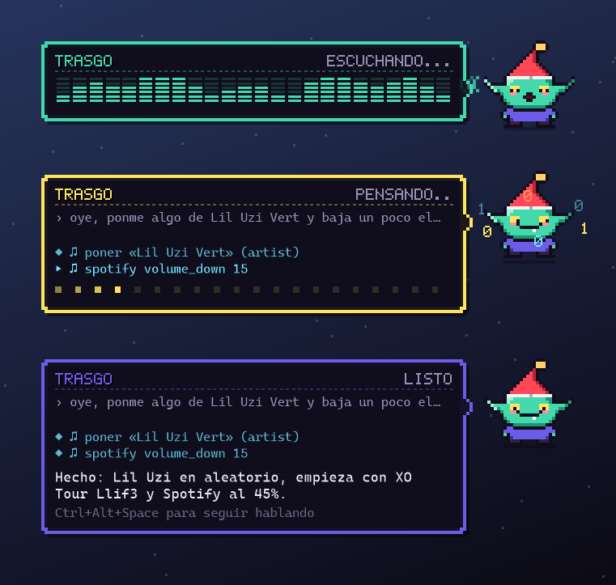
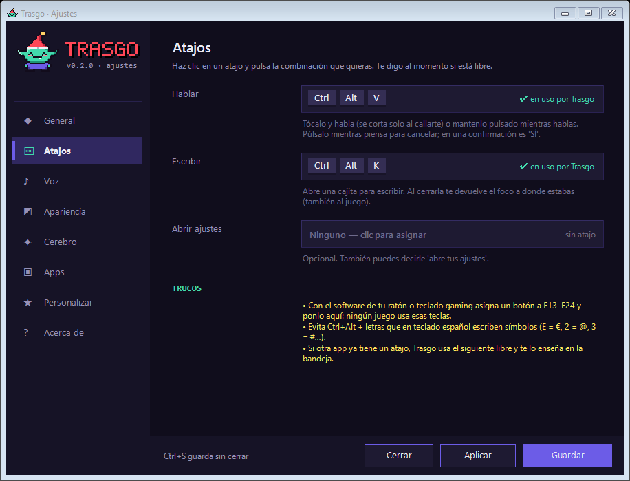
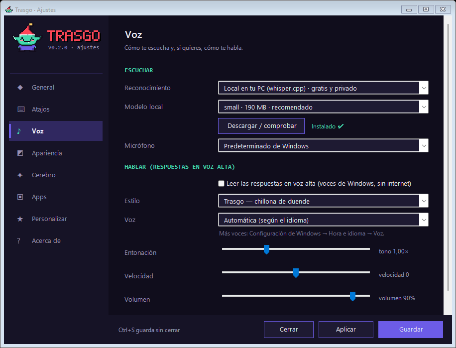
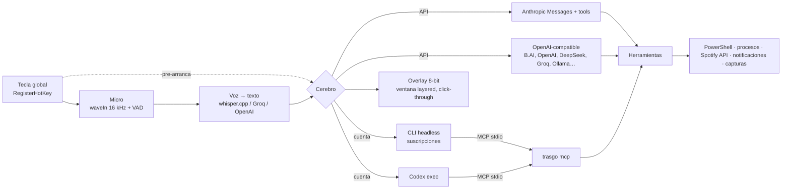

<p align="center">
  
</p>

<p align="center">
  <a href="https://github.com/marcosdeaza/trasgo/releases/latest"></a>
  
  
  
  
  <a href="LICENSE"></a>
</p>

**Trasgo** es un asistente con IA para Windows que vive en segundo plano y aparece encima de lo que estés haciendo (sí, también encima del Fortnite) cuando pulsas una tecla. Le hablas, se pone a pensar con su animación 8-bit, y *¡pum!*: te cambia la canción, te cierra el launcher colgado, te lee los mensajes de Discord o te arregla el PC. Sin cerrar el juego, sin cambiar de ventana y sin comerse tu RAM.

> El **trasgo** es el duende travieso del folclore asturiano y cántabro: pequeño, con gorro rojo, vive en tu casa y te hace las tareas… o te las lía. Este vive en tu PC y, de momento, solo te las hace.

<p align="center"></p>

## Qué le puedes decir

| Tú dices… | Trasgo hace… |
|---|---|
| *"Cambia la canción"* · *"pasa"* · *"para la música"* | Controla Spotify (o cualquier reproductor con las teclas multimedia) |
| *"Ponme algo de Lil Uzi Vert"* (aunque la voz lo escriba "lucibert") | Corrige el nombre, busca el artista y lo pone en aleatorio |
| *"Pon una playlist mía para entrenar"* | Lee tus playlists, elige la que encaja y la pone |
| *"Ponme algo que me guste, sorpréndeme"* | Mira tus artistas top y lo escuchado hace poco, y elige |
| *"¿Me ha escrito alguien?"* · *"¿tengo notificaciones?"* | Te resume quién te ha escrito (Discord, WhatsApp, Telegram, Steam…) |
| *"El Fortnite no me arranca"* | Revisa procesos, Easy Anti-Cheat, el launcher y los eventos de Windows, arregla lo obvio y te cuenta qué ha hecho |
| *"No me abre Steam, ¿lo reinicias?"* · *"Epic se ha quedado pillado"* | Cierra todos sus procesos (también los auxiliares tipo steamwebhelper) y lo vuelve a abrir |
| *"¿Cómo optimizo el PC?"* · *"quiero más FPS"* | Revisa plan de energía, Modo Juego, Game DVR, programas de inicio, temporales, RAM, disco, driver… y te da los 2-4 cambios que de verdad importan (y los aplica si se lo pides) |
| *"Va a tirones, ¿qué se está comiendo la CPU?"* | Mide CPU/RAM/GPU y te dice el culpable (y lo cierra si se lo pides) |
| *"¿Tengo lag?"* · *"no tengo internet"* | Ping, jitter y pérdida al router/Cloudflare/Google, DNS y señal WiFi en ~2 s |
| *"Avísame en 10 minutos de que saque la pizza"* | Aparece encima del juego a esa hora con un pitido |
| *"Dile a Dani por Discord que en 5 min me conecto"* · *"llama a Dani"* | Te enseña el mensaje, confirmas con la tecla y lo envía / llama (Discord ~2 s y te devuelve a donde estabas) |
| *"Silénciame"* · *"no quiero oír el Discord"* · *"baja el juego"* | Micro de Windows y volumen por app (mezclador), sin tocar ninguna ventana |
| *"Clipéalo"* · *"haz captura"* | Guarda el replay / captura con NVIDIA o Xbox Game Bar sin salir del juego |
| *"¿Qué hay en el puerto 3000?"* · *"libera el 8080"* | Para devs: puertos en escucha y qué proceso los usa |
| *"Contéstame más corto"* · *"háblame en inglés"* · *"pon la voz chillona"* | Se cambia sus propios ajustes y los guarda |
| *"¿Cuándo sale la nueva temporada?"* | Lo busca en internet |
| *"Cierra el Chrome"* · *"abre Steam"* | Mata o abre programas |
| *"Baja el volumen al 30"* | Volumen de Windows o de Spotify / Apple Music |
| *"Reinicia el PC"* | Te pide confirmación (otra pulsación de la tecla) y lo hace |
| *"Hazme un script que ordene mis descargas por tipo"* | Lo escribe, lo guarda y te dice dónde |
| *"¿Qué pone en esta ventana de error?"* | Hace una captura y te lo explica |

> **Regla de oro: nunca te saca del juego.** Todo lo que abre lo abre en segundo plano y, si algo le roba el foco, te lo devuelve. Solo sale de verdad para escribir/llamar por Discord, y te lo pregunta antes.

Funciona como un agente: encadena herramientas hasta terminar (hasta 16 pasos) y en el bocadillo ves en directo lo que va haciendo. Y le puedes pedir varias cosas a la vez: *"cierra el Chrome, limpia temporales y ponme algo de Yeat"*.

## Instalación (1 minuto)

1. Descarga **`trasgo.exe`** de [Releases](https://github.com/marcosdeaza/trasgo/releases/latest) y déjalo donde quieras (por ejemplo `%LOCALAPPDATA%\Programs\Trasgo`).
2. Ábrelo. La primera vez salen los **Ajustes**: elige cerebro, voz y atajos y dale a **Guardar**. Ya está: desde ese momento vive en segundo plano y arranca con Windows.
3. Pulsa el atajo de hablar (por defecto `Ctrl+Alt+Space`; la bandeja del sistema te dice el tuyo) y habla. Para abrir los ajustes en cualquier momento: `Ctrl+Alt+S`.

No necesita instalar nada más: usa el .NET Framework 4.8 que ya trae Windows 10/11.

> **SmartScreen / antivirus:** el exe no está firmado (cuesta dinero), así que Windows puede decir *"Windows protegió su PC"* → *Más información* → *Ejecutar de todas formas*. Si te fías poco, [compílalo tú](#compilar-desde-el-código) en 10 segundos.

## Cerebros

El cerebro es intercambiable y **cualquier API compatible con OpenAI vale** (con soporte de *tools* / function calling):

| Opción | Para quién | Cómo |
|---|---|---|
| **API compatible OpenAI** · *por defecto* | La mayoría | Presets listos para **B.AI**, **OpenAI**, **DeepSeek**, **OpenRouter**, **Groq** u **Ollama** (local y gratis). O pon URL base + key + modelo a mano. |
| **API de Anthropic** | Tienes API key de Anthropic | Directa, sin arrancar ningún CLI. |
| **Cuenta de Claude (Pro/Max)** | Tienes suscripción de Claude | Vía el CLI de Claude Code oficial en modo headless. Instálalo y haz login una vez. El consumo cuenta en tu plan. |
| **Cuenta de ChatGPT (Codex)** · *experimental* | Tienes ChatGPT Plus/Pro | Vía el [Codex CLI](https://github.com/openai/codex) oficial (`npm i -g @openai/codex`, login con `codex`). |

Las API keys se guardan **cifradas con DPAPI** (solo tu usuario de Windows puede leerlas) en `%APPDATA%\Trasgo\config.json`. En *Ajustes → Cerebro* hay un botón **Probar cerebro** que te dice en un par de segundos si la combinación key + modelo tira.

## Voz

| Opción | Latencia típica | Coste |
|---|---|---|
| **Local (whisper.cpp)** · *por defecto* | 1,4 – 2,2 s en CPU (medido en un i7-11700K, con un juego abierto) | Gratis y privado. El botón *Descargar* de los ajustes baja whisper.cpp (~8 MB) y el modelo (`small` ~190 MB). Solo usa CPU unos segundos mientras transcribe. |
| **Groq** | ~0,5 s (aprox.) | Gratis con cuenta (whisper-large-v3-turbo) |
| **OpenAI** | ~1 s (aprox.) | De pago (gpt-4o-mini-transcribe) |

Opcional (apagado por defecto): que **lea las respuestas en voz alta** con las voces de Windows, sin internet, con voz de duende chillona, normal o robot 8-bit.

## Atajos

- **Hablar** (`Ctrl+Alt+Space` por defecto): **tócalo y habla** (se corta solo cuando te callas) o **mantenlo pulsado** mientras hablas (push-to-talk). Si lo pulsas mientras piensa, **cancela**. Si te pide confirmación, pulsarlo es **SÍ**.
- **Escribir** (`Ctrl+Alt+T` por defecto): abre una cajita para escribir (con gracia de foco: si el juego intenta robarla en el primer segundo y medio, la cajita gana).
- **Ajustes** (`Ctrl+Alt+S` por defecto): abre la ventana de ajustes. Si otra app ya usa el atajo, Trasgo coge el siguiente libre.
- Si otra app usa un atajo, Trasgo coge solo el siguiente libre (`Ctrl+Alt+V`, `Ctrl+Alt+Z`… / `Ctrl+Alt+K`, `Ctrl+Alt+J`…) y lo muestra en la bandeja. Cámbialos en ajustes.
- **Truco gamer:** con el software de tu ratón o teclado asigna un botón a **F13–F24** y ponlo como atajo. Ningún juego usa esas teclas.

## Ajustes

Todo se configura desde una ventana limpia (icono de la bandeja, `Ctrl+Alt+S` o diciéndole *"abre tus ajustes"*): **cerebro** con presets y botón de prueba, **atajos** que se graban pulsándolos (y te dice si están libres), **idioma** (automático, español, inglés, portugués, chino o ruso), **largo de las respuestas** (corta / estándar / larga), **voz** con estilo *trasgo* chillón, normal o robot 8-bit + entonación, velocidad y volumen (apagada por defecto), **overlay** completo, compacto o *solo sonidos*, posición y tamaño con vista previa, y **apps** (Spotify, Apple Music, Discord).

<p align="center"> </p>

## Spotify

Sin conectar, Trasgo solo puede *play/pausa/siguiente/anterior* con las teclas multimedia (y bajar su volumen desde el mezclador). Para que busque y ponga lo que le pidas sin tocar ninguna ventana, conéctalo **una sola vez**:

**El camino corto:** pulsa **Conectar Spotify** (en *Ajustes → Apps*) o dile *"conecta Spotify"*. Se abre el navegador → inicias sesión → **copias la URL a la que te lleva** (Ctrl+L y Ctrl+C) → listo, Trasgo la pilla del portapapeles y termina solo. Un minuto.

**A mano (una sola vez):**

1. Entra en [developer.spotify.com/dashboard](https://developer.spotify.com/dashboard) → **Create app**.
2. Redirect URI: `http://127.0.0.1:43821/callback` · API: **Web API**. (Si tu app ya usa otra URI — por ejemplo la de tu propio repo — pon esa misma en *Ajustes → Apps → Redirect URI* y funcionará igual.)
3. Copia el **Client ID** en *Ajustes → Apps* y pulsa **Conectar**.

En *Ajustes → Apps* tienes un botón **Probar** que comprueba si el token guardado sigue vivo. Si Spotify te lo revoca (pasa si autorizas otra vez en el dashboard), basta con decir *"conecta Spotify"* otra vez.

Controlar la reproducción por API requiere **Spotify Premium** (limitación de Spotify). Cada colega usa su propia app de Spotify: el Client ID no es secreto, pero el token sí, y se queda cifrado en tu PC.

## Apple Music (experimental)

Si usas la app de Apple Music (o iTunes) en Windows: `am_status` dice qué suena (por el título de la ventana), `am_control` usa las teclas multimedia (play/pausa/pasar) y el volumen va por el mezclador de Windows (*"baja el Apple Music"*), sin tocar ninguna ventana. No hay API oficial para la app de Windows, así que no busca canciones concretas: para eso está Spotify.

## Discord (y otras apps)

Trasgo **no usa tu token de Discord ni hace self-bot** (eso va contra los términos de Discord y te pueden banear). En su lugar:

1. Lee las **notificaciones que Windows ya guardó** (DMs, menciones y grupos de Discord; también WhatsApp, Telegram, Steam…). Necesita que Windows tenga activadas las notificaciones de esa app. Con el *No molestar* de Windows (que se activa solo al jugar) no te salta nada en pantalla, pero se siguen guardando.
2. Si no hay notificaciones, **mira la ventana de Discord** aunque esté detrás del juego (no minimizada) y la lee como lo harías tú.

## Herramientas

45 de serie, más las tuyas:

- **PC:** `system_status` · `list_processes` · `kill_process` · `start_program` · `restart_app` · `power` · `volume` · `media_key` · `run_powershell`
- **Optimizar:** `optimize_scan` · `gaming_tweaks` · `clean_temp` · `power_plan` · `startup_apps`
- **Red y avisos:** `network_check` · `reminder` · `open_url` (+ búsqueda web)
- **Música:** `spotify_status` · `spotify_control` · `spotify_play` · `spotify_search` · `spotify_playlists` · `spotify_play_uri` · `spotify_queue` · `spotify_taste` · `am_status` · `am_control` · `am_volume`
- **Mensajes:** `inbox` · `discord_messages` · `discord_send` · `discord_call` · `app_notifications` · `window_capture`
- **Audio y juego:** `mic` · `app_volume` · `game_clip`
- **Devs y Trasgo:** `dev_ports` · `spotify_connect` · `trasgo_settings`
- **Archivos y pantalla:** `read_file` · `write_file` · `list_dir` · `screenshot` · `clipboard`

## Hazlo tuyo

Todo es texto plano en `%APPDATA%\Trasgo` (o *Ajustes → Personalizar*):

- **`instrucciones.md`**: quién eres y cómo quieres que te hable. *"Llámame Marcos, háblame como un colega de Madrid, mis colegas de Discord son Dani y Pablo, mi playlist de entrenar es Gym…"*
- **`tools\*.ps1`**: tus propios comandos. Cualquier script de PowerShell con esta cabecera se convierte en una herramienta que Trasgo usa sola cuando encaja (se recargan en caliente):

```powershell
# trasgo: Modo gaming. Cierra navegadores y launchers que sobran y pone el plan de alto rendimiento.
# param keep: Programas que NO hay que cerrar, separados por comas (opcional)
param([string]$keep = '')
# ... tu código ...
```

Hay un ejemplo completo en `tools\modo_gaming.ps1.ejemplo`: quítale el `.ejemplo` y ya puedes decir *"modo gaming"*.

## Probado de verdad

`trasgo eval` lanza **67 peticiones reales** tal y como llegan de la voz (con faltas tipo *"lucibert"*, *"estín"*, combos de varias cosas…) contra el cerebro de verdad en **modo simulación**: lo que solo lee (procesos, red, disco…) se ejecuta de verdad, y lo que cambiaría algo (matar procesos, reiniciar, poner música, tus mensajes) se simula. Comprueba qué herramientas elige, con qué argumentos y que la respuesta sea corta y sin markdown.

| Grupo | Casos |
|---|---|
| Música (nombres mal escritos, playlists propias, gustos, volumen, combos) | 14 |
| Mensajes y notificaciones | 4 |
| Arreglar cosas (Steam/Epic/Discord/barra de tareas, ventanas de error, lag, RAM, reinicio) | 11 |
| Optimizar (escaneo, aplicar, Modo Juego/Game DVR, temporales, energía, inicio) | 8 |
| Red, avisos, web, GPU, disco, multitarea | 8 |
| Discord (enviar/llamar), micro, volumen por app, clips | 7 |
| Devs (puertos, VS Code) | 3 |
| Cambiar sus propios ajustes por voz | 5 |
| Spotify sin conectar | 3 |
| Programación y charla | 4 |

### Seguridad

- **Reiniciar/apagar**, comandos de PowerShell peligrosos (formatear, borrar carpetas del sistema, tocar el registro de máquina…) y **sobrescribir archivos** piden confirmación: el bocadillo se pone naranja y tienes 10 s para pulsar la tecla. Si no la pulsas, no se hace.
- Nunca mata procesos críticos de Windows (csrss, lsass, winlogon, dwm…) ni a sí mismo.
- Todo corre en tu PC. Lo único que sale es lo que mandas al proveedor de IA que elijas (y a Spotify si lo conectas). Sin telemetría.

### ¿Me van a banear del Fortnite?

No hay motivo: Trasgo **no toca el proceso del juego** (ni lee su memoria, ni inyecta nada, ni usa hooks de teclado globales). Los atajos van con `RegisterHotKey` de Windows, igual que Discord u OBS, y el overlay es una ventana transparente normal "siempre encima" que no recibe clics. Para que se vea encima, usa **pantalla completa en ventana**. En pantalla completa exclusiva también suele verse con las optimizaciones de pantalla completa de Windows 11.

## Rendimiento

Hecho para gente que purga procesos:

- **~285 KB** de exe, sin dependencias ni runtime extra.
- **~8 MB de RAM en reposo** (working set) y **0 % de CPU**: no hay polling, ni timers, ni nada en marcha hasta que pulsas la tecla. Recorta su memoria después de cada uso.
- La animación solo se dibuja mientras el overlay está visible y corre con prioridad *por debajo de lo normal*, para no quitarle frames al juego.
- Con los cerebros por CLI (suscripción), el CLI **arranca en cuanto pulsas la tecla** (mientras hablas) y se cierra solo pasados los minutos de memoria. Medido: de 12,7 s en frío a **3–5 s** para responder.
- Las cerebros por API no arrancan nada: primera respuesta en ~1–3 s.
- La voz local usa contexto de audio ajustado al clip y decodificación *greedy*: de 6,3 s a **1,8 s** con el mismo texto.

## Línea de comandos

```text
trasgo                    arranca en segundo plano
trasgo settings           abre los ajustes
trasgo ask "texto"        pregunta desde la terminal (sin overlay)
trasgo ask --overlay "…"  se lo manda al Trasgo que está corriendo
trasgo whisper-setup      descarga la voz local
trasgo transcribe a.wav   transcribe un audio (16 kHz mono)
trasgo mcp                servidor MCP con todas las herramientas (stdio)
trasgo selftest           pruebas internas (no toca nada)
trasgo eval [filtro]       67 peticiones reales en modo simulación
trasgo assets <dir>       regenera el banner, el logo y las capturas
trasgo quit               cierra el Trasgo en segundo plano
```

### Úsalo como servidor MCP

Todas las herramientas de Trasgo se pueden usar desde cualquier cliente MCP:

```json
{
  "mcpServers": {
    "trasgo": {
      "type": "stdio",
      "command": "%LOCALAPPDATA%\\Programs\\Trasgo\\trasgo.exe",
      "args": ["mcp"]
    }
  }
}
```

## Cómo funciona



- **Un solo exe en C#** para .NET Framework 4.8 (incluido en Windows) con WinForms y P/Invoke a Win32: ventana *layered* con alpha por píxel, `RegisterHotKey`, `waveIn`, Core Audio, `winsqlite3` (también incluido en Windows) y DPAPI. JSON, MCP y el resto están hechos a mano, sin paquetes NuGet.
- Toda la pixel art (la mascota, sus 9 caras, la fuente 5×7, el icono y el banner de este README) sale del mismo código: [`src/Sprites.cs`](src/Sprites.cs) y [`src/Assets.cs`](src/Assets.cs).

## Novedades 0.3.0

- **Spotify sin baile**: la conexión acepta la Redirect URI que tengas en tu dashboard (aunque no sea 127.0.0.1) y pilla el código solo del portapapeles: inicias sesión, copias la URL (Ctrl+L, Ctrl+C) y listo. Si el token caduca o se revoca, te lo dice claro y te ofrece reconectar. Botón *Probar* en ajustes.
- **Cajita de escribir a prueba de juegos**: si el foco pelea en el primer segundo, la cajita gana y no desaparece sin dejar escribir.
- **Atajo de ajustes de serie** (`Ctrl+Alt+S` o el siguiente libre): los ajustes siempre están a una tecla.
- **Preset B.AI** y cerebro por defecto = API compatible OpenAI (los presets rellenan URL y modelo solos).
- **Apple Music (experimental)**: `am_status`, `am_control` y volumen por app.
- Ajustes reordenados: lo que usarás (API compatible) primero.

## Compilar desde el código

```powershell
git clone https://github.com/marcosdeaza/trasgo
cd trasgo
.\build.ps1 -Test     # → dist\trasgo.exe + selftest
```

No hace falta Visual Studio ni el SDK de .NET: el script baja el compilador Roslyn de nuget.org la primera vez (~20 MB) y compila contra el .NET Framework de Windows. Compila con prioridad baja, así que puedes hacerlo mientras juegas.

## Roadmap

- [ ] Palabra de activación opcional ("oye trasgo") con un detector local ultraligero
- [ ] Enviar mensajes (Discord vía webhook o bot propio, WhatsApp vía portapapeles)
- [ ] Memoria a largo plazo automática (de momento: `instrucciones.md`)
- [ ] Apple Music: buscar y poner canciones concretas (requiere API oficial, si llega)
- [ ] Más skins de la mascota y temas de color
- [ ] Instalador con winget

## Créditos

Hecho por [@marcosdeaza](https://github.com/marcosdeaza). Licencia [MIT](LICENSE). Spotify, Apple Music, Discord, Fortnite y ChatGPT son marcas de sus respectivos dueños; Trasgo no está afiliado a ninguno.
